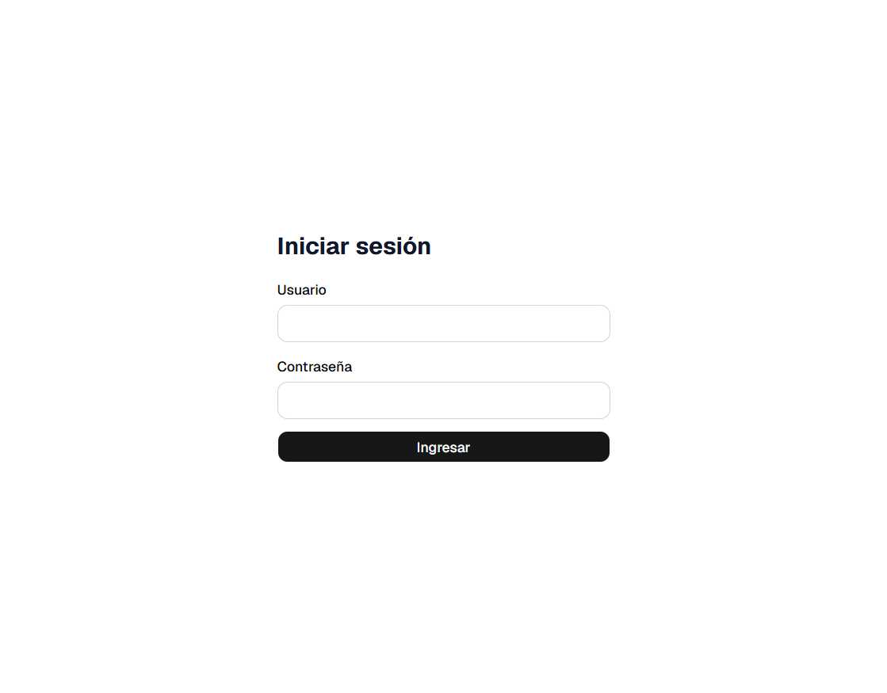
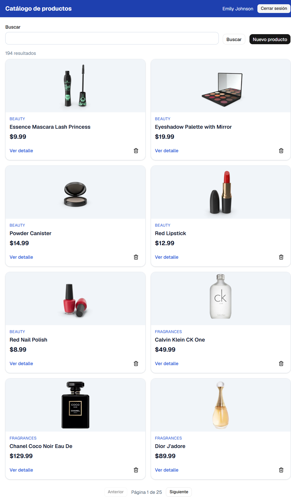
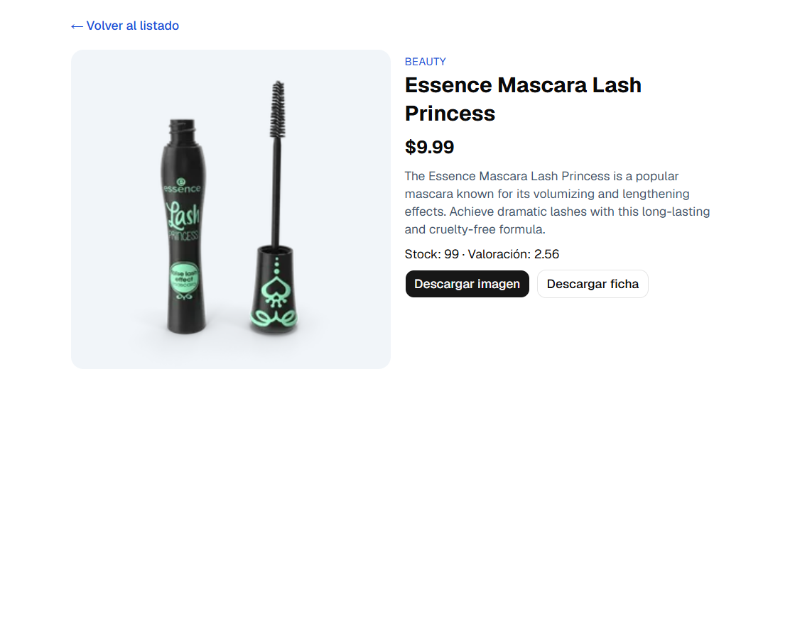
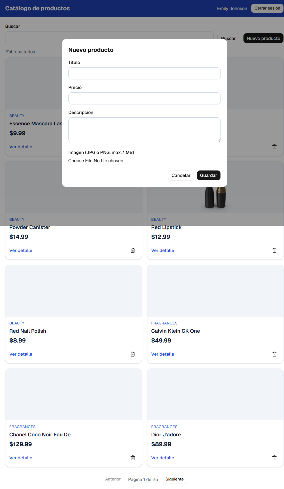

# Catálogo de productos

Aplicación web para consultar y buscar productos usando la API de [DummyJSON](https://dummyjson.com). Incluye inicio de sesión, rutas protegidas, paginación con estado en la URL, detalle de productos, descargas, creación y eliminación simuladas.

## Capturas

### Inicio de sesión



### Catálogo



### Detalle del producto



### Nuevo producto



## Requisitos

- Node.js compatible con Vite 8
- npm

## Instalación y ejecución

```bash
npm ci
npm run dev
```

La aplicación usa `https://dummyjson.com` de forma predeterminada. Opcionalmente, configure `VITE_API_URL` para usar otra URL de API.

Credenciales de prueba de DummyJSON:

```text
Usuario: emilys
Contraseña: emilyspass
```

## Comandos

```bash
npm run dev      # Servidor local
npm run build    # Verificación de TypeScript y compilación de producción
npm run lint     # ESLint
npm run preview  # Vista previa de la compilación
```

## Tecnologías

- React y TypeScript
- Vite y Tailwind CSS
- React Router
- TanStack React Query
- Zustand con persistencia
- Axios
- React Hook Form y Zod

## API y persistencia

La autenticación y las consultas de productos se realizan contra DummyJSON. La API simula las operaciones de creación y eliminación; esos cambios no se guardan en el servidor.

## Despliegue

El proyecto incluye `vercel.json` para que las rutas internas funcionen al desplegar en Vercel. **Enlace del sitio desplegado:** pendiente de publicación.
